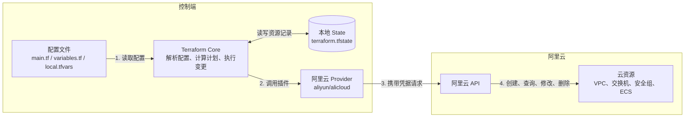

# 第 2 天：Terraform 命令行资源交付

使用第一天制作的基础镜像，通过 Terraform 创建两台 ECS，完成登录验证、配置变更与资源销毁。

## 一、Terraform 的工作原理

### 1.1 Terraform 是什么

Terraform 是基础设施即代码工具，用 HCL 配置描述需要的云资源，例如 VPC、交换机、安全组和 ECS。

它是命令行程序，不需要作为服务一直运行。修改配置后，执行命令才会检查或调整云资源；命令结束后，云资源仍由阿里云运行和计费。

本项目中，Packer 负责“制作什么样的镜像”，Terraform 负责“用这份镜像创建哪些主机，以及主机需要什么网络和规格”。



图中各部分的分工：

- **配置文件**：描述希望得到的环境，例如创建两台云服务器，使用哪个镜像、什么规格，以及连接哪个网络。
- **Terraform Core**：Terraform 的核心程序，读取配置、分析资源依赖，结合 State 和 Provider 查询到的云端情况，生成创建、修改或删除的计划；执行时按照依赖关系安排操作。
- **Provider**：连接 Terraform 与公有云平台的插件，将 Core 的资源操作转换为对应云厂商的 API 请求，并返回资源 ID、IP 等信息。不同云厂商使用各自的 Provider。
- **公有云 API 与云资源**：云平台接收请求，在云端实际创建、查询、修改或删除虚拟网络、子网、安全组和云服务器等资源。
- **本地 State**：Terraform 的资源“账本”，记录配置中的资源地址与云端实际资源的对应关系。例如，配置中声明的某台云服务器对应云平台中的哪个实例 ID，使后续操作能够找到正确的资源。默认保存在 `terraform.tfstate` 中。

例如首次执行 `apply` 时，Terraform 创建 VPC 并记录其 ID；再次执行时，就可以查询同一个 VPC，判断是否需要修改，而不是重复创建。执行 `destroy` 时，也通过这份记录确定要删除哪些受管资源。

**配置描述“希望是什么样”，State 记录“管理的是哪些资源”。** State 不是实时监控，也不是云资源本身；删除 State 文件不会删除云资源，只会丢失管理记录。

### 1.2 Terraform 如何操作阿里云

Terraform 不会模拟人在控制台点击按钮，而是通过 Provider 调用云厂商 API。

```text
Terraform 配置 → Terraform → 阿里云 Provider → 阿里云 API → 云资源
```

Provider 是 Terraform 的插件，负责实现某个云厂商的资源创建、查询、修改和删除。本项目使用 `aliyun/alicloud`，通过 AccessKey 访问本人的阿里云账号。

### 1.3 配置、State 与实际资源

| 内容 | 含义 | 本项目示例 |
| --- | --- | --- |
| 配置文件 | 希望资源是什么样 | 两台 ECS、各 40 GiB 系统盘 |
| State | Terraform 管理的资源记录 | 哪个资源地址对应哪个 ECS ID |
| 实际资源 | 云端当前真实存在的资源 | 阿里云上的 ECS、VPC、安全组 |

执行计划时，Terraform 会查询已管理资源的实际情况，结合配置和 State 判断需要创建、修改还是删除。[执行计划说明](https://developer.hashicorp.com/terraform/cli/commands/plan)

常用流程：

```text
init 初始化 → plan 预览 → apply 执行 → destroy 销毁
```

## 二、认识工程文件

进入工程的 Terraform 目录：

```bash
cd /你的项目目录/Iac/terraform
```

| 文件 | 作用 |
| --- | --- |
| `versions.tf` | 指定 Terraform、Provider 版本和 Provider 配置 |
| `variables.tf` | 定义变量类型、默认值和校验规则 |
| `local.tfvars` | 保存本次实验的地域、镜像、规格等参数 |
| `credentials.auto.tfvars` | 保存本人的 AccessKey，自动加载 |
| `main.tf` | 定义要创建的网络、安全组和 ECS |
| `outputs.tf` | 定义执行后输出的主机信息 |

同一目录内的 `.tf` 文件会作为一套配置共同加载。文件名用于整理内容，不决定执行顺序。

### 2.1 versions.tf：版本与 Provider

```hcl
terraform {
  required_version = "~> 1.16.0"

  required_providers {
    alicloud = {
      source  = "aliyun/alicloud"
      version = "= 1.294.0"
    }
  }
}

provider "alicloud" {
  region     = var.region
  access_key = var.access_key_id
  secret_key = var.access_key_secret
}
```

- `required_version`：要求使用 Terraform 1.16.x。
- `required_providers`：声明工程需要哪些插件。
- `source`：Provider 的来源标识，不是本地目录。
- `version`：固定使用的 Provider 版本。
- `provider "alicloud"`：配置该插件使用的地域和访问凭据。
- `var.region`：引用名为 `region` 的输入变量。

### 2.2 variables.tf 与 local.tfvars：定义和赋值

`variables.tf` 定义变量：

```hcl
variable "region" {
  type    = string
  default = "cn-hangzhou"
}
```

`local.tfvars` 给变量赋值：

```hcl
region = "cn-hangzhou"
```

没有显式赋值时使用 `default`；既没有赋值也没有默认值时，Terraform 会要求提供变量。

使用工程现有的 `local.tfvars`，核对以下参数：

| 参数 | 用途 |
| --- | --- |
| `region` | 实验地域，与基础镜像所在地域一致 |
| `zone_id` | 交换机和 ECS 所在的可用区 |
| `image_id` | 第一天制作的自定义镜像 ID |
| `owner` | 本人的资源名称前缀和标签标识 |
| `ssh_cidr` | 允许 SSH 登录的来源网段，建议使用当前出口公网 IP 加 `/32` |
| `ssh_key_pair_name` | 已在该地域创建的 ECS 密钥对名称，不是私钥文件路径 |
| `control_plane_instance_type` | 控制节点规格 |
| `worker_instance_type` | 工作节点规格 |
| `public_bandwidth_mbps` | 公网出方向带宽上限，默认 5 Mbps |

后两种节点规格在 `variables.tf` 中有默认值，也可以在 `local.tfvars` 中覆盖。实际使用该可用区可购买的规格。

### 2.3 credentials.auto.tfvars：访问凭据

将本人的 AccessKey 保存在本地 `credentials.auto.tfvars` 中，格式如下：

```hcl
access_key_id     = "你的 AccessKey ID"
access_key_secret = "你的 AccessKey Secret"
```

Terraform 自动读取 `*.auto.tfvars`，不需要每次执行 `export`。`local.tfvars` 则需要通过 `-var-file=local.tfvars` 指定。

凭据文件仅在本地保留，不提交 Git，不放入截图或录屏。

## 三、main.tf 如何描述云资源

### 3.1 resource 的写法

```hcl
resource "alicloud_vpc" "lab" {
  vpc_name   = "${local.name_prefix}-vpc"
  cidr_block = "172.20.0.0/16"
  tags       = local.common_tags
}
```

- `resource`：声明一个由 Terraform 管理的资源。
- `alicloud_vpc`：资源类型，表示阿里云 VPC，由 Provider 定义。
- `lab`：该资源在工程中的名称，可以自行命名。
- `vpc_name`：云控制台中显示的 VPC 名称。
- `cidr_block`：VPC 使用的私有网络范围。
- `local.name_prefix`、`local.common_tags`：引用 `locals` 中定义的名称前缀和公共标签。

`alicloud_vpc.lab` 是 Terraform 资源地址，不是阿里云生成的资源 ID。

### 3.2 网络与资源引用

VPC 是 Virtual Private Cloud，即专有网络。交换机位于 VPC 内，用于为该可用区的主机分配私网地址。

```hcl
resource "alicloud_vswitch" "lab" {
  vpc_id       = alicloud_vpc.lab.id
  zone_id      = var.zone_id
  vswitch_name = "${local.name_prefix}-vswitch"
  cidr_block   = "172.20.1.0/24"
  tags         = local.common_tags
}
```

`alicloud_vpc.lab.id` 表示读取前面 VPC 的 `id` 属性。创建前，这个 ID 尚未确定；创建成功后，Provider 从阿里云获得 ID，Terraform 再把它传给交换机配置。

因此不需要先在控制台创建 VPC，再手动复制 ID。Terraform 能通过引用判断依赖，先创建 VPC，再创建交换机。

### 3.3 安全组与 SSH 规则

安全组控制主机允许哪些网络访问。工程将两台 ECS 放入同一安全组，并允许组内主机互通。

SSH 规则的主要配置：

```hcl
type        = "ingress"
ip_protocol = "tcp"
port_range  = "22/22"
policy      = "accept"
cidr_ip     = var.ssh_cidr
```

| 字段 | 含义 |
| --- | --- |
| `type = "ingress"` | 入方向规则；出方向为 `egress` |
| `ip_protocol = "tcp"` | 匹配 TCP 流量 |
| `port_range = "22/22"` | 目标端口为 22 |
| `policy = "accept"` | 允许访问 |
| `cidr_ip` | 允许访问的来源 IP 或网段 |

家庭网络也有出口公网 IP，可能由运营商动态分配。出口 IP 变化后，需要同步更新 `ssh_cidr` 并执行 `apply`。

### 3.4 使用 for_each 创建两台 ECS

`locals` 中的 `nodes` 定义两台主机的差异：

| 配置键 | hostname | 私网 IP | 预定角色 |
| --- | --- | --- | --- |
| `control_plane` | `iac-个人标识-cp` | `172.20.1.10` | control-plane |
| `worker` | `iac-个人标识-worker` | `172.20.1.11` | worker |

ECS 资源通过 `for_each` 遍历这份配置：

```hcl
resource "alicloud_instance" "nodes" {
  for_each = local.nodes

  instance_name = each.value.host_name
  host_name     = each.value.host_name
  image_id      = var.image_id
  instance_type = each.value.instance_type
  private_ip    = each.value.private_ip

  vswitch_id      = alicloud_vswitch.lab.id
  security_groups = [alicloud_security_group.cluster.id]
  key_name        = var.ssh_key_pair_name

  # 其余配置见 main.tf
}
```

`each.key` 是当前配置键，`each.value` 是对应的主机配置。同一个资源块因此生成两个实例，而不是复制两份相似代码。

其余主要参数：

| 参数 | 含义 |
| --- | --- |
| `system_disk_category = "cloud_essd_entry"` | 使用 ESSD Entry 系统盘 |
| `system_disk_size = 40` | 每台主机的系统盘为 40 GiB，两台共两块 |
| `instance_charge_type = "PostPaid"` | ECS 按量付费 |
| `internet_charge_type = "PayByTraffic"` | 公网按流量计费 |
| `internet_max_bandwidth_out` | 公网出方向带宽上限，不等于镜像下载的入方向限速 |
| `tags` / `volume_tags` | 给实例和云盘添加项目、所有者、角色等标签 |
| `depends_on` | 显式要求 SSH 规则先创建，再创建 ECS |

这里的 `Role` 标签只是记录预定用途，并不会安装 Kubernetes。第三天由 Ansible 完成实际的控制面初始化和 worker 加入。

## 四、通过命令行创建资源

### 4.1 初始化

在 `terraform` 目录执行：

```bash
terraform init
```

`init` 会下载 Provider、初始化工作目录，不会创建 ECS。

初始化后可看到：

- `.terraform/`：Provider 等工作文件。
- `.terraform.lock.hcl`：Provider 版本和校验信息，用于保持依赖一致，不是 State。

### 4.2 检查配置

```bash
terraform fmt -check
terraform validate
```

`fmt -check` 检查格式，`validate` 检查配置语法及内部引用。格式不符合时可执行 `terraform fmt`。

这两项检查不会验证账号权限或云端库存。

### 4.3 查看执行计划

```bash
terraform plan -var-file=local.tfvars
```

`plan` 会访问云 API，但不会执行计划中的创建、修改或删除。

| 符号 | 含义 |
| --- | --- |
| `+` | 创建 |
| `~` | 原地更新 |
| `-` | 删除 |
| `-/+` 或 `+/-` | 替换资源，即删除并重新创建 |
| `(known after apply)` | 执行后才能获得的值，例如新资源 ID |

空环境首次执行当前工程，预计创建 1 个 VPC、1 个交换机、1 个安全组、1 条 SSH 规则和 2 台 ECS：

```text
Plan: 6 to add, 0 to change, 0 to destroy.
```

检查地域、镜像、实例规格、磁盘和 SSH 来源网段是否符合预期。

### 4.4 执行创建

```bash
terraform apply -var-file=local.tfvars
```

Terraform 会重新生成计划，确认后输入 `yes`。从实际创建收费资源开始产生费用。

若需要执行与预览完全相同的一份计划，可以保存后应用：

```bash
terraform plan -var-file=local.tfvars -out=day02.tfplan
terraform apply day02.tfplan
```

两种方式选择一种即可。保存的计划文件不提交 Git。

## 五、查看结果并登录主机

### 5.1 outputs.tf 输出什么

`outputs.tf` 将两台主机的信息整理为 `nodes` 输出，包括实例 ID、hostname、角色、私网 IP、公网 IP 和规格。

创建结束后会显示在命令行，也可以再次查询：

```bash
terraform output nodes
terraform output -json nodes
```

`role` 来自工程中定义的节点配置，公网 IP 和实例 ID 则来自创建后的云资源。

### 5.2 使用 SSH 登录

使用创建 ECS 时绑定的密钥对所对应的私钥：

```bash
chmod 600 /你的私钥路径/密钥.pem
ssh -i /你的私钥路径/密钥.pem root@控制节点公网IP
```

退出后登录另一台：

```bash
exit
ssh -i /你的私钥路径/密钥.pem root@工作节点公网IP
```

### 5.3 验证基础镜像

分别在两台 ECS 上执行：

```bash
hostname
ip -4 addr
containerd --version
systemctl status containerd --no-pager
ctr -n k8s.io images ls
```

检查主机名、私网 IP 是否与配置一致，containerd 是否运行，以及第一天预缓存的 Calico、Argo CD 等镜像是否存在。

## 六、State：记录 Terraform 管理的资源

本工程使用本地 State，默认文件是当前目录下的 `terraform.tfstate`。其中保存资源地址与云端资源 ID 的对应关系等信息。[State 说明](https://developer.hashicorp.com/terraform/language/state)

回到控制端的 `terraform` 目录，查看资源列表：

```bash
terraform state list
```

当前工程创建成功后，应包含：

```text
alicloud_instance.nodes["control_plane"]
alicloud_instance.nodes["worker"]
alicloud_security_group.cluster
alicloud_security_group_rule.ssh
alicloud_vpc.lab
alicloud_vswitch.lab
```

查看某台主机的记录：

```bash
terraform state show 'alicloud_instance.nodes["control_plane"]'
```

`control_plane` 是 `for_each` 的配置键，不是 hostname。State 中记录的 `id` 才是阿里云实例 ID。

State 不是云资源本身：删除 State 文件不会删除 ECS，反而会丢失管理关系。不要手动编辑或删除 State，也不要将其提交 Git。

## 七、修改配置并观察变化

### 7.1 修改 VPC 显示名称

在 `main.tf` 的 `alicloud_vpc.lab` 中，将：

```hcl
vpc_name = "${local.name_prefix}-vpc"
```

改为：

```hcl
vpc_name = "${local.name_prefix}-vpc-demo"
```

先预览：

```bash
terraform plan -var-file=local.tfvars
```

预期只出现 VPC 名称的原地更新，即 `~`，没有 ECS 重建。确认计划符合预期后执行：

```bash
terraform apply -var-file=local.tfvars
```

在云控制台查看名称，再次执行 `plan`，应看到 `No changes`。

修改镜像、网络等配置可能触发资源替换，不能把所有参数变更都理解为原地更新。

### 7.2 在控制台修改后，Terraform 会怎么处理

假设上一步执行完成后，代码和云端的 VPC 名称都是 `iac-allen-vpc-demo`。现在只在云控制台将名称改为 `manual-vpc`，不修改代码。

此时两边的值分别是：

| 位置 | VPC 名称 |
| --- | --- |
| Terraform 代码 | `iac-allen-vpc-demo` |
| 云端实际资源 | `manual-vpc` |

执行：

```bash
terraform plan -var-file=local.tfvars
```

Terraform 先通过 State 中的 VPC ID 找到原来的 VPC，再通过 Provider 查询它的当前名称。发现名称与代码不一致后，会生成原地更新计划，关键内容如下：

```text
~ vpc_name = "manual-vpc" -> "iac-allen-vpc-demo"

Plan: 0 to add, 1 to change, 0 to destroy.
```

箭头左边是云端当前值，右边是准备修改成的值。**执行 `plan` 只会显示计划，此时云端名称仍然是 `manual-vpc`。**

继续执行并确认：

```bash
terraform apply -var-file=local.tfvars
```

云端名称才会被改回 `iac-allen-vpc-demo`，VPC ID 不变，不会重建。

如果希望保留 `manual-vpc`，则应将代码中的 `vpc_name` 也改为 `"manual-vpc"`，再执行 `plan`，而不是让 Terraform 将其改回。

**Terraform 以代码表达的配置为目标，不会自动把控制台的修改写回代码，也不会在后台持续纠正差异。**

## 八、销毁实验资源（必做！！）
‼️**创建资源后这一步必须完成，不做的话会持续计费**

当天实验结束，在原 `terraform` 目录执行：

```bash
terraform destroy -var-file=local.tfvars
```

核对待删除资源，输入 `yes`。Terraform 会按照依赖关系回收本工程管理的 ECS 和网络资源。

完成后检查：

```bash
terraform state list
```

正常清理后列表应为空，再到云控制台核对对应 ECS、系统盘和网络资源的释放结果。

本工程不管理 Packer 基础镜像、关联快照和已有 SSH 密钥对，它们不会被此次 `destroy` 删除；镜像相关快照仍可能计费。代码和 State 文件继续保留，第三天使用同一工程重新创建主机。

## 九、常见问题

| 现象 | 检查方向 |
| --- | --- |
| `no valid credential sources` 或凭据为空 | 检查 `credentials.auto.tfvars` 文件名、变量名和 Provider 配置 |
| `IncompleteSignature` | 核对 AccessKey ID 与 Secret 是否配对、有无多余空白，以及控制端系统时间 |
| `ResourceNotAvailable` | 核对地域、可用区及实例规格是否可用 |
| 找不到镜像或密钥对 | 核对它们是否位于当前地域、是否属于本人账号或已获共享权限 |
| SSH 超时 | 检查公网 IP、实例状态、安全组 22 端口和 `ssh_cidr` |
| SSH 认证失败或连接关闭 | 核对登录用户、私钥和 ECS 绑定的密钥对，并查看服务端 SSH 日志 |
| 公网 IP 无法 ping 通 | 当前工程未单独放行公网 ICMP，不能仅据此判断 SSH 不通 |
| 重建后 SSH 提示主机密钥变化 | 确认目标是本人重建的主机，再用 `ssh-keygen -R 公网IP` 清除对应旧记录 |
| 执行中途失败 | 修复报错后重新 `plan`；已创建成功的资源可能仍在，不要删除 State 后重新开始 |
