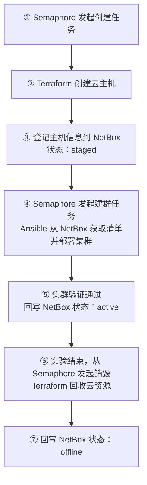

# 第 4 天：运维平台集成

在个人控制端部署 Semaphore 和 NetBox，将前三天已经跑通的 Terraform、Ansible 流程接入平台，完成主机创建、资产登记、集群初始化和资源回收。

## 一、为什么引入运维平台与 CMDB

### 1.1 两个概念

- **运维平台**：统一执行部署、巡检和资源回收等任务，并保存执行记录。本项目使用 Semaphore，运行已有的 Terraform 和 Ansible 代码。
- **CMDB**：Configuration Management Database，配置管理数据库，集中记录服务器、IP、状态及资源之间的关系。本项目使用 NetBox 承担简化的基础设施 CMDB 职责。

### 1.2 为什么需要引入

企业中有多名运维人员、多个业务环境，不能只依靠个人电脑上的命令和手工维护的 IP 列表。Semaphore 提供统一任务入口和日志，NetBox 提供资产信息和动态主机清单，减少重复操作与信息遗漏。

例如，企业需要交付一套测试集群：通过平台创建主机，将资产登记到 NetBox，再根据主机角色执行 Ansible，完成后更新交付状态。后续巡检、配置变更和资源回收，也可以复用这些任务和资产信息。

**Semaphore 管“执行什么操作”，NetBox 管“操作哪些资源”。**

### 1.3 本项目各组件的分工

| 组件 | 在本项目中的作用 |
| --- | --- |
| Semaphore | 提供任务执行入口、参数配置和日志页面 |
| Terraform | 调用云 API，创建或销毁云资源，维护 State |
| NetBox | 记录主机名、IP、角色和交付状态，为 Ansible 提供主机信息 |
| Ansible | 读取动态 Inventory，执行已有 Roles，安装并验证集群 |
| PostgreSQL | 保存 NetBox 数据 |
| Valkey | 提供 NetBox 使用的 Redis 兼容缓存和任务队列 |

本日流程：



平台不会替代 Terraform 或 Ansible，只是将原来的命令组织成可从页面执行的任务。

### 1.4 本地运行什么、云端运行什么

- 个人控制端：Docker、Semaphore、NetBox，以及数据库和缓存。
- Semaphore 容器：Terraform、Ansible 及集成脚本。
- 公有云：两台 ECS 及其网络、系统盘，Kubernetes 安装在这两台主机上。

每人独立部署平台，不共用平台数据库或云账号。

## 二、部署本地平台

### 2.1 安装 Docker 与 Compose

在 Rocky Linux 9 控制端执行，已安装时直接检查版本：

```bash
sudo dnf install -y dnf-plugins-core
sudo dnf config-manager --add-repo https://mirrors.aliyun.com/docker-ce/linux/centos/docker-ce.repo
sudo dnf install -y docker-ce docker-ce-cli containerd.io docker-buildx-plugin docker-compose-plugin
sudo systemctl enable --now docker
docker --version
docker compose version
```

软件源使用阿里云镜像，保留包签名校验。

### 2.2 初始化平台配置

进入平台目录：

```bash
cd /你的项目目录/Iac/platform
python3 platformctl.py init --ssh-key /你的私钥路径/密钥.pem
```

`platformctl.py` 是课程工程提供的辅助脚本。此次 `init` 会：

- 生成 `platform/.env`，记录项目目录、平台密码和 API Token 等配置。
- 将 SSH 私钥复制到 `platform/secrets/ecs_ssh_key`，原私钥保留。
- 已存在 `.env` 时保留原配置，不重新生成 Token。

Terraform 继续使用原来的 `terraform/local.tfvars` 和 `terraform/credentials.auto.tfvars`，无需将云密钥手工填进每个任务模板。

### 2.3 启动服务并初始化平台对象

```bash
python3 platformctl.py up
python3 platformctl.py status
```

`up` 会依次构建 Semaphore 执行镜像、启动 Compose 服务、初始化 NetBox 和 Semaphore 对象，并检查工具环境。**此命令不创建云主机。**

初始化完成后，NetBox 已有课程所需的集群、角色和自定义字段；Semaphore 已有 `IaC Lab` 项目及任务模板。无需逐项手工录入这些基础对象。

检查服务状态，以下为示意：

```text
SERVICE          STATE
postgres         running / healthy
redis            running / healthy
netbox           running / healthy
netbox-worker    running / healthy
semaphore        running / healthy
```

### 2.4 登录平台

| 平台 | 默认地址 | 用户名 | 初次生成配置时的密码 |
| --- | --- | --- | --- |
| Semaphore | http://localhost:3001 | admin | admin |
| NetBox | http://localhost:8000 | admin | admin |

端口只绑定控制端的 `127.0.0.1`，默认账号用于个人本地实验，不直接对公网开放。

如果通过 Xshell 等工具连接虚拟机，需要配置 SSH 隧道，才能从宿主机这些本地端口。也可以在宿主机终端执行：

```bash
ssh -L 3001:127.0.0.1:3001 -L 8000:127.0.0.1:8000 用户名@控制端IP
```

保持连接，再打开个人电脑上的浏览器访问上述地址。

## 三、理解平台文件和目录挂载

### 3.1 主要文件的作用

| 文件 | 作用 |
| --- | --- |
| `platformctl.py` | 生成配置、启动平台、初始化对象和查看状态 |
| `compose.yaml` | 定义服务、环境变量、端口、依赖和挂载 |
| `.env` | 保存本人的本地运行配置，不提交 Git |
| `semaphore/Dockerfile` | 为 Semaphore 配置 Terraform、Ansible 和 Python 依赖 |
| `jobs/run.sh` | 根据任务参数，调用相应命令并串联前后处理 |
| `netbox/bootstrap.py` | 初始化 NetBox 管理员、Token、角色和字段 |
| `sync_netbox.py` | 读取 Terraform 输出，通过 API 登记或更新 NetBox 资产 |
| `check_inventory.py` | 检查动态清单中的分组和关键主机变量 |
| `../ansible/inventory/netbox.yml` | 从 NetBox 查询资产，生成 Ansible Inventory |

不要求重新开发这些脚本，重点理解它们的输入、输出和调用关系。

### 3.2 本地文件如何进入 Semaphore

`compose.yaml` 中的关键挂载：

```yaml
volumes:
  - ${IAC_PROJECT_DIR:?Run init first}:/workspace
  - ./secrets:/run/iac-secrets:ro
```

| 控制端位置 | Semaphore 容器内位置 |
| --- | --- |
| `Iac/terraform` | `/workspace/terraform` |
| `Iac/ansible` | `/workspace/ansible` |
| `Iac/platform/jobs/run.sh` | `/workspace/platform/jobs/run.sh` |
| `Iac/platform/secrets/ecs_ssh_key` | `/run/iac-secrets/ecs_ssh_key` |

因此修改控制端工程文件，容器内就能读取到对应修改，不需要每次上传脚本或重建镜像。

`IAC_PROJECT_DIR` 由 `init` 写入 `.env`。辅助脚本调用 Compose 时，会显式加载该文件。

### 3.3 Terraform State 保存在哪里

平台在 `/workspace/terraform` 中运行 Terraform，仍然使用 `default` workspace。

由于该目录是控制端工程的挂载，容器中的 `terraform.tfstate` 对应的就是控制端 `Iac/terraform/terraform.tfstate`，不是另外创建一份独立 State。

**命令行和平台共用资源管理记录，不要在两边同时执行 Terraform 创建或销毁。**

NetBox 保存的是资产信息，不能代替 Terraform State；删除 NetBox 记录也不会删除云主机。

## 四、认识 Semaphore 任务模板

### 4.1 本日使用的模板

进入 Semaphore 的 `IaC Lab` 项目，打开 Task Templates。本日只使用 `00` 至 `06`：

| 模板 | 传入 run.sh 的参数 | 执行内容 |
| --- | --- | --- |
| `00 检查执行环境` | `check` | 检查 Terraform、Ansible 和 NetBox 相关依赖 |
| `01 预览云资源计划` | `plan` | 执行 Terraform plan |
| `02 创建云资源并登记 NetBox（收费）` | `apply` | 创建资源，成功后登记资产 |
| `03 重新登记 NetBox` | `import` | 重新读取现有 Terraform 输出并登记 |
| `04 查看 NetBox 主机清单` | `inventory` | 通过动态插件查询主机分组 |
| `05 Ansible 自动创建 Kubernetes` | `cluster` | 检查主机清单、部署集群、回写 active |
| `06 销毁云资源并更新 NetBox（删除）` | `destroy` | 销毁云资源，成功后回写 offline |

### 4.2 一个模板如何对应脚本

打开 `00 检查执行环境` 的编辑页面，查看：

| 配置 | 当前值 |
| --- | --- |
| 类型 | Bash Script |
| Repository | `IaC workspace` |
| Repository 路径 | `/workspace` |
| Environment / Variable Group | `IaC runtime` |
| Inventory | `NetBox dynamic inventory` |
| 脚本路径 | `platform/jobs/run.sh` |
| 参数 | `["check"]` |

点击 Run 后，相当于容器内执行：

```bash
bash /workspace/platform/jobs/run.sh check
```

不同模板复用同一个脚本，只是传入不同参数。`run.sh` 的 `case` 分支决定运行检查、创建、部署还是销毁。

本工程使用本地目录作为 Repository，不要求先推送到远端 Git 仓库。[Semaphore Repository 说明](https://docs.semaphoreui.com/user-guide/repositories/)

### 4.3 执行环境检查

运行 `00 检查执行环境`，打开任务日志，检查 Terraform、Ansible 版本，以及 NetBox 插件、Python 依赖是否可用。

也可以参照这个模板，新建一个同样传入 `check` 的只读模板，验证模板配置与执行结果的关系。

## 五、从平台创建云资源

### 5.1 预览计划

运行 `01 预览云资源计划`，核对：

- 地域、镜像和实例规格。
- 两台主机及其网络、系统盘。
- SSH 来源网段和使用的密钥对。

它与第二天的 `terraform plan -var-file=local.tfvars` 使用同一套配置。

### 5.2 创建并登记资产

确认计划后，运行 `02 创建云资源并登记 NetBox（收费）`。

当前脚本使用 `-auto-approve`，页面发起任务后不会再要求输入 `yes`。`01` 没有保存计划文件，`02` 会重新计算并执行计划。

对应的关键逻辑位于 `jobs/run.sh`：

```bash
terraform apply -input=false -auto-approve -var-file=local.tfvars
python3 ../platform/sync_netbox.py
```

先完成云资源创建，再执行资产登记。登记脚本读取 `terraform output -json nodes`，获取 hostname、IP、角色和实例 ID。

正常日志会包含类似内容，名称以实际输出为准：

```text
Apply complete! Resources: 6 added, 0 changed, 0 destroyed.
...
iac-student-cp -> staged
iac-student-worker -> staged
```

## 六、在 NetBox 查看资产与交付状态

### 6.1 查看两台虚拟机

进入 NetBox 的“虚拟化 → 虚拟机”，打开本人的节点记录，检查：

| 内容 | 预期 |
| --- | --- |
| Name | 与 Terraform 输出的 hostname 一致 |
| Cluster | `iac-lab` |
| Role | 控制节点为 Control plane，工作节点为 Worker |
| Primary IPv4 | 本次创建主机的公网 IP |
| 标签 | `iac-course` |
| 自定义字段 `private_ip` | 对应主机私网 IP |
| 自定义字段 `cloud_instance_id` | 对应 ECS 实例 ID |
| Status | 初次创建完成后为 `staged` |


### 6.2 统一资产状态

| 状态值  | 表示什么                                 |
| ------- | ---------------------------------------- |
| staged  | 云主机已创建，尚未通过本流程完成集群交付 |
| active  | Ansible 部署和验证流程成功结束           |
| offline | 对应云资源已由本流程销毁，保留资产记录。 |

## 七、理解 NetBox 动态 Inventory

### 7.1 与第三天的静态清单有什么区别

第三天在 `ansible/inventory/hosts.yml` 中手工填写主机和变量；本日使用 `ansible/inventory/netbox.yml` 定义查询规则，由插件从 NetBox 获取主机信息。

动态清单在内存中生成，不会生成或覆盖 `hosts.yml`。

### 7.2 连接 NetBox 并筛选主机

`netbox.yml` 指定使用 `netbox.netbox.nb_inventory` 插件，通过环境变量获取连接信息：

| 环境变量 | 用途 |
| --- | --- |
| `NETBOX_API` | API 服务地址，容器内为 `http://netbox:8080` |
| `NETBOX_TOKEN` | 查询主机使用的只读 Token |

这些变量由 Compose 传入 Semaphore 容器。`netbox` 是 Compose 内部服务名；浏览器访问页面则使用 `localhost:8000`。

插件只查询带 `iac-course` 标签、Status 为 `staged` 或 `active` 的虚拟机，排除已回写为 `offline` 的资产。

### 7.3 命令行直接查询 NetBox API

在 NetBox 右上角用户菜单的 API Tokens 页面获取本人的只读 Token，在运行平台的主机上执行：

```bash
NETBOX_TOKEN="你的完整只读 Token"

curl -sS \
  -H "Authorization: Bearer ${NETBOX_TOKEN}" \
  'http://localhost:8000/api/virtualization/virtual-machines/?tag=iac-course&status=staged&status=active' \
  | python3 -m json.tool
```

`/api/virtualization/virtual-machines/` 是虚拟机查询接口；URL 中的参数用于筛选课程标签，以及 `staged` 或 `active` 状态。

返回结果示例（仅保留关键字段）：

```json
{
  "count": 2,
  "results": [
    {
      "name": "iac-student-cp",
      "status": {"value": "staged", "label": "Staged"},
      "role": {"name": "Control plane", "slug": "control-plane"},
      "primary_ip4": {"address": "203.0.113.10/32"},
      "custom_fields": {"private_ip": "172.20.1.10", "cloud_instance_id": "i-example-cp"}
    },
    {
      "name": "iac-student-worker",
      "status": {"value": "staged", "label": "Staged"},
      "role": {"name": "Worker", "slug": "worker"},
      "primary_ip4": {"address": "203.0.113.11/32"},
      "custom_fields": {"private_ip": "172.20.1.11", "cloud_instance_id": "i-example-worker"}
    }
  ]
}
```

`count` 是匹配数量，`results` 是主机列表。后面的 Inventory 配置正是从这些字段中取值，例如 `role.slug` 读取角色标识，`primary_ip4.address` 读取公网 IP。

### 7.4 将查询结果转换为 Ansible 清单

打开 `ansible/inventory/netbox.yml`，查看关键配置：

```yaml
groups:
  control_plane: "role.slug == 'control-plane'"
  workers: "role.slug == 'worker'"

compose:
  ansible_host: primary_ip4.address.split('/')[0]
  node_hostname: name
  private_ip: custom_fields.private_ip
  node_role: role.slug
```

- 根据 NetBox 中的角色，将主机放入 `control_plane` 或 `workers`。
- 公网 IP 转换为 `ansible_host`，供控制端 SSH 登录。
- 私网 IP 转换为 `private_ip`，供 Kubernetes 节点间通信。
- SSH 私钥使用容器内挂载路径，不再沿用控制端 Inventory 中的私钥路径。

### 7.5 执行查询并查看结果

运行 `04 查看 NetBox 主机清单`，执行流程如下：

```text
Semaphore 执行 run.sh inventory
  → ansible-inventory 读取 inventory/netbox.yml
  → 插件连接 NetBox，按条件查询虚拟机
  → 转换为 Ansible 主机分组和变量
  → 输出清单
```

实际在 Semaphore 容器中执行：

```bash
cd /workspace/ansible
ansible-inventory -i inventory/netbox.yml --graph
```

日志应包含控制节点和 worker 分组。例如：

```text
@control_plane:
  |--iac-xxx-cp
@workers:
  |--iac-xxx-worker
```

该任务只查询清单，不会登录 ECS。

## 八、通过平台执行 Ansible 建群

### 8.1 执行已有集群入口

确认 `04` 中主机分组正确后，运行 `05 Ansible 自动创建 Kubernetes`。

当前模板仍是 Bash 类型，因为需要把清单校验、Ansible 执行和成功后的状态回写串起来。真正的集群部署依然使用第三天的 `cluster.yml` 和各个 Role，不是重新开发另一套安装逻辑。

脚本的关键流程（[platform/jobs/run.sh](../../platform/jobs/run.sh)，第 48–51 行）：

```bash
ansible-inventory -i inventory/netbox.yml --list | python3 ../platform/check_inventory.py
ansible all -i inventory/netbox.yml -m ping
ansible-playbook -i inventory/netbox.yml cluster.yml
python3 ../platform/sync_netbox.py --status active
```

执行顺序：

1. 检查是否有 1 个控制节点、至少 1 个 worker，以及有效 IP 等变量。
2. 测试 Ansible 连通性。
3. 执行系统准备、控制面、Calico、worker 加入与集群验证。
4. 前面全部成功后，将资产交付状态回写为 `active`。

脚本启用了失败即停止。Inventory 为空、SSH 失败或 Playbook 失败时，不会继续正常回写 `active`。

#### 实践：创建原生 Ansible 模板

在 Semaphore 的 Task Templates 页面点击 New Template，选择 **Ansible Playbook**，填写：

| 配置项 | 填写内容 |
| --- | --- |
| Name | `Ansible 建群示例` |
| Repository | `IaC workspace` |
| Playbook Filename | `ansible/cluster.yml` |
| Inventory | `NetBox dynamic inventory` |
| Environment | `IaC runtime` |
| Arguments | 留空 |

保存后点击 Run，查看各个 Role 的执行日志及最后的 `PLAY RECAP`。

该模板直接调用 Ansible，核心命令相当于：

```bash
ansible-playbook -i /workspace/ansible/inventory/netbox.yml /workspace/ansible/cluster.yml
```

Inventory 插件从 NetBox 获取主机和 SSH 私钥路径，Ansible 再通过 SSH 登录 ECS，执行集群部署任务。

两种模板使用的是同一份 `cluster.yml`，区别在于：

- **原生 Ansible 模板**：直接执行 Playbook，适合学习和单独运行部署任务；不会执行 `run.sh` 中的额外清单校验和 NetBox 状态回写。
- **现有 `05` Bash 模板**：将清单校验、SSH 测试、部署及状态回写串联起来，用于本项目的完整交付流程。

### 8.2 验证结果

在 Semaphore 日志中检查 `PLAY RECAP`，两台主机均应为 `failed=0`、`unreachable=0`。

在控制节点检查：

```bash
kubectl get nodes -o wide
kubectl -n kube-system get pods -o wide
```

如果第三天已经将 `test.yml` 接入 `cluster.yml`，本次也会执行该测试流程。

回到 NetBox，确认两个节点的 Status 为 Active（`active`）。

## 九、完整流程验收与资源回收

### 9.1 本日完成标准

| 环节 | 完成标准 |
| --- | --- |
| 本地平台 | Semaphore、NetBox 可登录，依赖服务正常 |
| 资源交付 | 从 Semaphore 创建两台 ECS，日志无失败 |
| 资产登记 | NetBox 中 hostname、IP、角色、实例 ID 正确 |
| 动态清单 | 正确生成 control_plane、workers 分组 |
| 集群部署 | 平台执行现有 Playbook，节点 Ready，验证通过 |
| 状态回写 | 创建后为 staged，建群成功后为 active |
| 资源回收 | 云资源释放，NetBox 回写 offline，动态清单排除这些节点 |

需要能够对照代码说明：模板参数如何传到 `run.sh`，Terraform 输出如何进入 NetBox，NetBox 字段如何成为 Ansible 变量，以及 `active` 在什么时候写入。

### 9.2 从平台销毁云资源

当天实验结束，运行 `06 销毁云资源并更新 NetBox（删除）`。此任务使用自动确认，执行前核对项目和目标资源。

脚本先保留当前节点信息，再执行 Terraform destroy，成功后回写 NetBox：

```text
Destroy complete! Resources: 6 destroyed.
...
iac-student-cp -> offline
iac-student-worker -> offline
```

数量以实际待销毁资源为准。到云控制台核对 ECS、系统盘和相关网络资源的释放结果，再运行 `04`，清单中不应继续出现这些节点。

NetBox 保留 Offline / offline 的 VM 记录，关联 IP 记录也不会被该脚本自动删除。这是保留的资产记录，不代表云主机仍在运行。

Packer 基础镜像和关联快照不在这套 Terraform 销毁范围内，仍需按前面课程的方式管理。

### 9.3 停止本地平台

确认云资源已回收后，在 `platform` 目录执行：

```bash
python3 platformctl.py stop
```

此命令停止本地服务、保留数据卷，**不会销毁云资源**。保留 `.env` 和数据卷，下一天继续使用；不要将停止平台当作云资源回收。

## 十、常见问题

| 现象 | 处理方向 |
| --- | --- |
| `up` 时镜像构建或启动失败 | 检查具体下载地址、Docker 网络、磁盘空间和服务日志 |
| 提示项目已移动 | 核对 `.env` 中的 `IAC_PROJECT_DIR` 是否对应当前目录 |
| 浏览器打不开页面 | 检查容器状态、端口占用，以及是否需要 SSH 隧道 |
| NetBox 登录出现 CSRF 错误 | 使用配置允许的 localhost / 127.0.0.1 地址，刷新登录页后重试 |
| Terraform 报凭据或签名错误 | 核对本地凭据文件，平台不会自动修复错误的 AccessKey |
| 云主机已创建，但 NetBox 没有记录 | 先修复资产登记错误，再运行 `03`，不必重新创建主机 |
| 动态清单为空 | 检查课程标签、VM 原生状态、角色、主 IP 以及只读 Token |
| Ansible 连接失败 | 检查 NetBox 公网 IP、挂载私钥和 SSH 安全组规则 |
| 部署失败，资产没有变为 active | 先检查 Playbook 失败任务，修复后重新运行 `05` |
| 重新登记后仍是 active | 同一个实例已交付成功时，这是脚本保留状态的正常行为 |
| 云资源已销毁，但状态回写失败 | 核对云端和 State 后，在 NetBox 修正为 offline / Offline，不要仅凭旧状态重新创建资源 |

在控制端查看日志：

```bash
cd /你的项目目录/Iac/platform
python3 platformctl.py status
python3 platformctl.py logs
```

先根据失败环节定位 Terraform、资产登记、动态清单还是 Ansible 的问题，不要通过删除 State、重置数据库或清空数据卷绕过报错。
