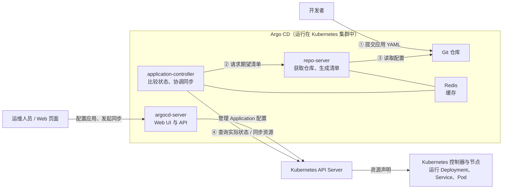

# 第 5 天：Argo CD 与 GitOps 持续交付

安装 Argo CD，连接 Git 仓库，完成应用首次部署、自动同步、自愈、资源清理和 Git 回退。

## 一、理解 GitOps 与 Argo CD

### 1.1 为什么将应用配置放在 Git 中

手工执行 `kubectl apply` 可以部署应用，但后续还需要知道：当前使用哪份配置、谁修改过、集群是否与代码一致、出错后如何恢复。

GitOps 将期望配置保存在 Git 中，由控制器持续比较代码和集群实际状态，并根据配置执行同步。

本项目使用 Argo CD 实现 Kubernetes 应用的 GitOps 交付。它不负责制作镜像或创建 ECS，而是管理 Deployment、Service 等 Kubernetes 资源。

### 1.2 Argo CD 如何工作

```text
修改应用 YAML 并推送到 Git
  → Argo CD 获取指定仓库、分支和目录
  → 比较 Git 配置与集群实际资源
  → 手动或自动执行同步
  → Kubernetes 根据资源声明运行应用
```

| 组件 | 主要作用 |
| --- | --- |
| `argocd-server` | 提供 Web 页面和 API |
| `argocd-repo-server` | 获取 Git 仓库内容，生成应用清单 |
| `argocd-application-controller` | 比较期望状态与实际状态，协调应用同步 |
| Redis | 为 Argo CD 提供缓存 |




`repo-server` 提供 Git 中的期望清单，`application-controller` 通过 Kubernetes API 比较和同步资源；不需要调用 `kubectl` 命令。

### 1.3 GitOps 与 CI/CD 的区别和联系

**区别**：CI/CD 关注代码如何自动完成集成、测试、构建和交付；GitOps 关注用 Git 保存环境的期望配置，并持续协调实际环境与配置保持一致。

**联系**：GitOps 可以作为 CI/CD 中持续交付的实现方式。持续集成产生新版本后，更新 Git 中的部署配置，再由 GitOps 将变更同步到环境。

## 二、重建集群并安装 Argo CD

### 2.1 恢复本地平台与云端集群

在控制端执行：

```bash
cd /你的项目目录/Iac/platform
python3 platformctl.py up
```

进入 Semaphore，按第四天的流程执行：

| 顺序 | 模板 | 检查结果 |
| --- | --- | --- |
| 1 | `01 预览云资源计划` | 确认本次资源范围与配置 |
| 2 | `02 创建云资源并登记 NetBox（收费）` | 主机已创建，资产状态为 staged |
| 3 | `04 查看 NetBox 主机清单` | 控制节点和 worker 分组正确 |
| 4 | `05 Ansible 自动创建 Kubernetes` | 集群验证通过，资产状态为 active |

主机重建后公网 IP 可能变化，后续 SSH 使用本次 Terraform 输出或 NetBox 中的地址。

### 2.2 执行 Argo CD 安装模板

运行 `07 Ansible 安装 Argo CD`。这个模板使用 Semaphore 原生 Ansible Playbook 类型：

| 配置 | 内容 |
| --- | --- |
| Repository | `IaC workspace` |
| Playbook | `ansible/argocd.yml` |
| Inventory | `NetBox dynamic inventory` |

`argocd.yml` 先检查 Inventory、SSH 连通性，再在控制节点执行 `argocd` Role：

1. 检查节点、Calico 和 CoreDNS 是否就绪。
2. 在执行端下载并缓存固定版本安装清单。
3. 渲染国内镜像地址，将清单上传到控制节点。
4. 创建 `argocd` 命名空间，应用清单并等待组件就绪。

### 2.3 查看组件状态

登录控制节点执行：

```bash
kubectl -n argocd get pods
kubectl -n argocd get deployments,statefulsets
```

确认组件就绪后，再连接应用仓库。安装 Argo CD 成功不代表已经部署了示例应用。

## 三、访问 Argo CD 页面

### 3.1 获取初始登录密码

在控制节点执行：

```bash
kubectl -n argocd get secret argocd-initial-admin-secret -o jsonpath='{.data.password}' | base64 -d
```

用户名为 `admin`，密码使用上述结果，不是本地 Semaphore 的 `admin` 密码。

### 3.2 建立访问通道

因为argocd部署在云上，需要建立隧道才能够访问。

在控制端新开终端执行：

```bash
ssh -t -i /你的私钥路径/密钥.pem \
  -L 18080:127.0.0.1:8080 root@控制节点公网IP \
  'kubectl --kubeconfig=/etc/kubernetes/admin.conf -n argocd port-forward --address=127.0.0.1 svc/argocd-server 8080:443'
```

保持终端运行，浏览器访问：

```text
https://localhost:18080
```

## 四、准备应用仓库与 Application

### 4.1 准备 Gitee 仓库与应用文件

由于阿里云对github访问不稳定，我们使用gitee。

在 Gitee 创建本人的公开空仓库 `iac-gitops-demo`，不勾选初始化 README。克隆仓库，将课程中的 `gitops` 内容复制进去：

```bash
cd ~
git clone https://gitee.com/your-account/iac-gitops-demo.git
cd iac-gitops-demo
git checkout -b main

cp /你的项目目录/Iac/gitops/application.yaml .
cp -r /你的项目目录/Iac/gitops/apps .
```

将 `your-account` 换成本人的 Gitee 用户名。后续修改、提交和推送均在这个独立仓库中进行。

复制后的目录结构：

```text
iac-gitops-demo/
├── application.yaml
└── apps/demo/
    ├── deployment.yaml
    └── service.yaml
```

### 4.2 认识现有应用清单

| 文件 | 作用 |
| --- | --- |
| `apps/demo/deployment.yaml` | 创建 Nginx Deployment，当前为 2 个副本，使用工程中固定的国内镜像 |
| `apps/demo/service.yaml` | 创建 ClusterIP Service，将流量转发到应用 Pod |
| `application.yaml` | 告诉 Argo CD 从哪里读取配置、部署到哪里、采用什么同步策略 |

后续实验通过修改副本数验证发布，不需要额外构建业务镜像。

### 4.3 配置 Application

修改独立仓库中的 `application.yaml`，仓库地址换成本人的 Gitee 地址：

```yaml
apiVersion: argoproj.io/v1alpha1
kind: Application
metadata:
  name: gitops-demo
  namespace: argocd
spec:
  project: default
  source:
    repoURL: https://gitee.com/your-account/iac-gitops-demo.git
    targetRevision: main
    path: apps/demo
  destination:
    server: https://kubernetes.default.svc
    namespace: gitops-demo
  syncPolicy:
    syncOptions:
      - CreateNamespace=true
```

| 字段 | 含义 |
| --- | --- |
| `metadata.namespace` | Application 对象保存于 `argocd` 命名空间 |
| `repoURL` | 实际存放应用清单的 Git 仓库地址 |
| `targetRevision` | 跟踪的分支，本课为 `main` |
| `path` | 应用清单目录，相对于 Git 仓库根目录 |
| `destination.server` | 目标集群，本例为 Argo CD 所在集群 |
| `destination.namespace` | 示例 Deployment、Service 部署到的命名空间 |
| `CreateNamespace=true` | 同步时自动创建目标命名空间 |

`path` 填写仓库内的 `apps/demo`，不是本地绝对路径。[Application 字段说明](https://argo-cd.readthedocs.io/en/stable/user-guide/application-specification/)

配置完成后，在 `~/iac-gitops-demo` 目录提交并推送：

```bash
git add application.yaml apps
git commit -m "Add GitOps demo manifests"
git push -u origin main
```

### 4.4 从 repo-server 测试仓库访问

在控制节点执行，使用与 `repoURL` 相同的实际地址：

```bash
kubectl -n argocd exec deploy/argocd-repo-server -- git ls-remote https://gitee.com/your-account/iac-gitops-demo.git HEAD
```

能返回提交哈希说明该容器可以读取仓库。只测试个人电脑能否访问 Git，并不能证明云端 repo-server 也能访问。

### 4.5 创建 Application

在控制端的 `~/iac-gitops-demo` 目录执行：

```bash
scp -i /你的私钥路径/密钥.pem application.yaml root@控制节点公网IP:/root/gitops-application.yaml
```

在控制节点执行：

```bash
kubectl apply -f /root/gitops-application.yaml
kubectl -n argocd get application gitops-demo
```

这里只手工创建 Application。应用 Deployment、Service 交给 Argo CD 同步，不再人工 `kubectl apply`。

## 五、完成第一次手动同步

在 Argo CD 页面打开 `gitops-demo`，检查 Repository、Revision、Path 和目标命名空间。首次尚未部署时，可能显示 `OutOfSync`、`Missing`。

点击 **Sync → Synchronize**，等待部署完成。在控制节点检查：

```bash
kubectl -n gitops-demo get deployment,pods,service
kubectl -n argocd get application gitops-demo
```

预期 Deployment 为 `2/2`，应用最终为 `Synced`、`Healthy`。

| 状态 | 表示什么 |
| --- | --- |
| `Synced` | 当前受管配置与 Git 期望配置一致 |
| `OutOfSync` | 存在需要同步的配置差异 |
| `Healthy` | 按资源健康规则判断运行正常 |
| `Progressing` / `Degraded` | 正在就绪或存在健康问题，需要继续检查 |

**同步状态和健康状态是两个维度**，不能将 `Synced` 直接理解为业务一定正常。

需要访问示例服务时，在控制端另开终端：

```bash
ssh -t -i /你的私钥路径/密钥.pem \
  -L 18081:127.0.0.1:8081 root@控制节点公网IP \
  'kubectl -n gitops-demo port-forward --address=127.0.0.1 svc/gitops-demo 8081:80'
```

浏览器访问 `http://localhost:18081`，应看到 Nginx 默认页面。

## 六、修改 Git 并验证自动同步

### 6.1 开启自动同步

在 Argo CD 网页中操作：

1. 打开应用 `gitops-demo`，点击左上角 **Details**。
2. 找到 **Sync Policy**，点击 **Enable Auto-Sync** 并确认。
3. 确认 **Prune Resources** 和 **Self Heal** 均未启用。

返回应用页面，确认不再显示 `Auto sync is not enabled`。这一步只开启自动同步，暂不开启自动删除和自愈。

### 6.2 通过 Git 修改副本数

在控制端，将 `apps/demo/deployment.yaml` 中的副本数从 2 改为 1：

```yaml
spec:
  replicas: 1
```

提交并推送：

```bash
git add -- apps/demo/deployment.yaml
git commit -m "demo: reduce replicas to one"
git push
```

不再手工点击 Sync，观察 Argo CD 获取新提交并同步。在控制节点检查：

```bash
kubectl -n gitops-demo get deployment gitops-demo
```

预期最终为 1 个副本，Argo CD 页面显示新的提交版本及 `Synced`、`Healthy`。

仓库变更需要等待轮询发现；也可以点击 Refresh 触发重新比较。**Refresh 是重新检查，Sync 才是执行同步；启用自动同步后，控制器会根据检查结果发起同步。**

## 七、手工修改集群，验证自愈

### 7.1 只开自动同步时观察差异

保持 Git 中 `replicas: 1` 不变，在控制节点执行：

```bash
kubectl -n gitops-demo scale deployment/gitops-demo --replicas=2
```

刷新 Argo CD，观察 `OutOfSync` 和 Diff：Git 要求 1 个副本，实际资源被改成了 2 个。

此时没有新 Git 提交，且 `selfHeal` 为 false，不会仅因为这次手工修改就自动纠正。

### 7.2 开启自愈并再次测试

在 Argo CD 网页中操作：

1. 打开应用 `gitops-demo`，点击 **Details**。
2. 找到 **Sync Policy**，在自动同步设置中启用 **Self Heal**，确认更改。
3. 保持 **Prune Resources** 未启用。

观察副本数自动恢复为 Git 中的 1：

```bash
kubectl -n gitops-demo get deployment gitops-demo -w
```

再手工扩为 2，验证是否再次恢复。自愈可能很快完成，可以通过持续观察副本数查看过程。

- 自动同步：Git 出现新版本后，自动向集群应用配置。
- 自愈：集群被手工改动后，自动恢复到 Git 所描述的配置。

## 八、使用 Prune 清理已从 Git 删除的资源

### 8.1 添加一个独立测试资源

在控制端新建 `apps/demo/prune-demo.yaml`：

```yaml
apiVersion: v1
kind: ConfigMap
metadata:
  name: prune-demo
data:
  purpose: gitops-prune-test
```

提交并推送：

```bash
git add -- apps/demo/prune-demo.yaml
git commit -m "demo: add prune test configmap"
git push
```

等待同步完成，在控制节点确认：

```bash
kubectl -n gitops-demo get configmap prune-demo
```

### 8.2 删除 Git 配置，观察未开启 Prune 的行为

在控制端执行：

```bash
git rm -- apps/demo/prune-demo.yaml
git commit -m "demo: remove prune test configmap"
git push
```

等待 Argo CD 获取本次提交。由于 `prune` 仍为 false，ConfigMap 不会自动删除，页面会提示该资源需要清理。

### 8.3 开启 Prune

在 Argo CD 网页中操作：

1. 打开应用 `gitops-demo`，点击 **Details**。
2. 找到 **Sync Policy**，在自动同步设置中启用 **Prune Resources**，确认更改。
3. 保持自动同步和 **Self Heal** 已启用。

观察自动同步后的结果，再查询：

```bash
kubectl -n gitops-demo get configmap prune-demo
```

预期返回 `NotFound`。本实验只删除没有被应用使用的测试 ConfigMap，不删除 Service、命名空间或整个 Application。

**Prune 清理的是该 Application 管理、但已不在 Git 期望配置中的资源，不是清空整个集群。**[自动同步、自愈和 Prune 说明](https://argo-cd.readthedocs.io/en/stable/user-guide/auto_sync/)

## 九、提交错误配置并通过 Git 回退

### 9.1 制造一次同步失败

在控制端将 Deployment 的副本数改为非法值：

```yaml
spec:
  replicas: -1
```

提交并推送：

```bash
git add -- apps/demo/deployment.yaml
git commit -m "test: invalid replica count"
git push
```

等待 Argo CD 检测新提交，查看同步报错。Kubernetes 会拒绝负数副本配置；已有应用可能仍正常运行，因此“本次同步失败”不等于“旧应用已经停止”。

### 9.2 撤销故障提交

在控制端撤销刚才的提交：

```bash
git revert --no-edit HEAD
git push
```

Git 会产生一条新的撤销提交，而不是删除历史。Argo CD 获取新版本后重新同步，应用应恢复到 1 个副本及 `Synced`、`Healthy`。

本课使用 Git revert 回退，不通过强制推送改写历史，也不只执行 `kubectl rollout undo`：Git 仍保留错误配置时，单独修改集群不能完成 GitOps 意义上的恢复。

## 十、保存配置并完成总验收

### 10.1 本日验收

| 项目 | 预期结果 |
| --- | --- |
| Argo CD 安装与访问 | 通过 Ansible 安装，能够登录页面 |
| 首次同步 | Application 能读取正确分支、目录，应用部署成功 |
| Git 驱动发布 | 修改副本数并推送，集群自动更新 |
| 差异与自愈 | 手工修改 Deployment 后，被恢复为 Git 中的配置 |
| Prune | 从 Git 删除测试 ConfigMap 后，集群对应资源被清理 |
| Git 回退 | 错误配置触发同步失败，revert 后恢复 |

### 10.2 回收实验资源

从 Semaphore 运行 `06 销毁云资源并更新 NetBox（删除）`，核对云资源释放、NetBox 状态回写及动态清单更新。

回收阿里云上的镜像资源，并且操作退款（需间隔24小时）。

确认云资源回收后，按第四天的方法停止本地平台。

## 十一、常见问题

| 现象 | 检查方向 |
| --- | --- |
| 仓库连接超时 | 从 repo-server 容器内验证访问，不只检查个人电脑网络 |
| 找不到分支或应用目录 | 核对 repoURL、targetRevision，以及相对于仓库根目录的 path |
| 已改本地 YAML，但没有同步 | 检查是否已经 commit、push，以及 Application 是否跟踪该分支 |
| 配置已推送，但未立即更新 | 等待轮询或点击 Refresh，再检查 Diff 和同步策略 |
| Synced，但 Pod 没有正常运行 | 查看 Pod Events、镜像拉取、资源配额及健康状态 |
| 手工修改后不恢复 | 核对自动同步和 selfHeal 是否均已启用 |
| Git 已删除资源，集群仍保留 | 核对 prune 是否启用，资源是否由当前 Application 管理 |
| 页面无法访问 | 检查 SSH 隧道、port-forward 终端及本次控制节点公网 IP |

控制节点上的常用排查命令：

```bash
kubectl -n argocd get application gitops-demo -o yaml
kubectl -n argocd logs deploy/argocd-repo-server --tail=50
kubectl -n gitops-demo get pods -o wide
kubectl -n gitops-demo describe deployment gitops-demo
kubectl -n gitops-demo get events --sort-by=.metadata.creationTimestamp
```
